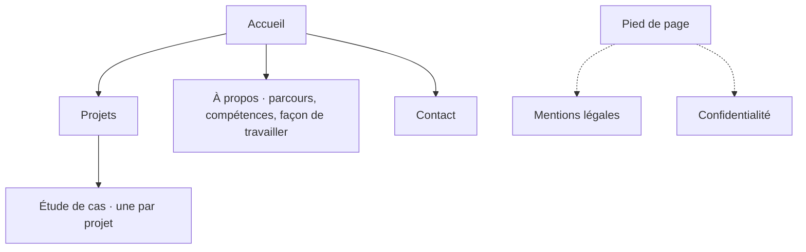

# Architecture de contenu et UX — Portfolio personnel

Version 1.0 — 14/10/2026 — **statut : validé**

S'appuie sur le PRD v0.2 (personas RH et tech lead, user stories, périmètre V1), le territoire de marque v0.2 et la direction artistique v1.0 « Affiche de nuit ».

---

## 1. Arborescence

- **En-tête, sur toutes les pages** : l'en-tête existant du propriétaire (Projets · À propos · Contact · FR / EN). Pas de bouton CV dans l'en-tête.
- **Pied de page, sur toutes les pages** : CV FR et EN, mail, LinkedIn, GitHub, mentions légales, confidentialité, lien vers le code du site. C'est lui qui rend le CV accessible depuis n'importe quelle page.
- **Page 404** : dans le ton du site, avec un retour vers l'accueil et les projets.

---

## 2. URLs

| Page | FR | EN |
|---|---|---|
| Accueil | `/fr` | `/en` |
| Projets | `/fr/projets` | `/en/projects` |
| Étude de cas | `/fr/projets/[slug]` | `/en/projects/[slug]` |
| À propos | `/fr/a-propos` | `/en/about` |
| Contact | `/fr/contact` | `/en/contact` |
| Mentions légales | `/fr/mentions-legales` | `/en/legal-notice` |
| Confidentialité | `/fr/confidentialite` | `/en/privacy` |

- La racine `/` redirige vers `/fr` (ou `/en` selon la langue du navigateur, à trancher en phase 7).
- Chaque page déclare sa version dans l'autre langue (`hreflang`) ; le sélecteur FR / EN mène à la page équivalente, pas à l'accueil.

---

## 3. Parcours utilisateurs

### P1 — Recruteur·se RH : télécharger le CV

1. Arrive sur l'accueil (souvent depuis un lien de candidature ou LinkedIn).
2. Comprend en quelques secondes : nom, poste, promesse.
3. Clique sur « Télécharger le CV » dans la section d'accueil. **Objectif atteint en 1 clic.**
4. Variante : ouvre **À propos** pour vérifier le parcours, puis télécharge le CV depuis le pied de page ou passe par **Contact**.

### P2 — Tech lead : lire une étude de cas, puis contacter

1. Arrive sur l'accueil, scrolle jusqu'aux trois projets.
2. Ouvre une étude de cas.
3. Lit la méthode et les choix techniques, puis ouvre le code sur GitHub (sauf stage au CNAM, code privé).
4. Passe au projet suivant ou revient à **Projets**.
5. Contacte via la section contact, le pied de page ou la page **Contact**.

---

## 4. Contenu par page

### Accueil

| # | Section | Rôle | Contenu |
|---|---|---|---|
| 1 | Section d'accueil (violette, plein écran) | Marquer les esprits, présenter | Nom, poste, promesse, boutons CV et contact (DA §6) |
| 2 | Trois projets | Donner envie d'ouvrir une étude de cas | La **sélection du moment** : 3 projets choisis à la main, remplacés quand un nouveau projet est plus pertinent ; lien « Tous les projets » |
| 3 | Qui je suis | Faire sentir la personnalité | Quelques lignes ; lien vers **À propos** |
| 4 | Ma façon de travailler | Montrer la méthode d'ingénieur | Les grandes étapes (besoin, méthode, code…) ; lien vers **À propos** |
| 5 | Prise de contact | Convertir | Appel au contact, bouton vers **Contact**, mail |

La sélection du moment est un réglage dans les fichiers de contenu (par exemple un champ `featured` sur chaque projet).

### Projets

| # | Section | Contenu |
|---|---|---|
| 1 | En-tête | Titre, une phrase d'introduction |
| 2 | Liste des projets | Cartes : capture mise en scène, titre, type, stack, une phrase. **Triée par date de sortie**, du plus récent au plus ancien |

Filtrage (par type ou par techno) : **V2**, conformément au PRD.

### Étude de cas (gabarit commun)

| # | Bloc | Contenu |
|---|---|---|
| 1 | En-tête | Titre, type de projet, rôle, durée, stack, liens (code, démo) |
| 2 | Contexte | Le cadre du projet |
| 3 | Besoin | Le problème de départ |
| 4 | Contraintes | Techniques, temps, matériel, équipe |
| 5 | Méthode | Comment le travail a été mené |
| 6 | Choix techniques | Décisions et compromis, argumentés |
| 7 | Résultats | Ce qui a été obtenu, chiffré quand c'est possible |
| 8 | Enseignements | Ce qui n'a pas marché et ce qui a été appris |
| 9 | Liens et suite | Code, démo ; projet suivant ; retour à la liste |

Temps forts animés au scroll (DA §6) : 1 ou 2 blocs par étude de cas, pas plus.

### À propos (fusion du parcours et de l'à-propos)

| # | Section | Contenu |
|---|---|---|
| 1 | En-tête | Titre, accroche personnelle |
| 2 | Mon histoire | Le déclic au lycée (bac STI2D, spécialité SIN), puis l'école d'ingénieur (ESIEA) ; les projets software qui ont confirmé le choix |
| 3 | Timeline | Parcours scolaire et professionnel : lycée, école, stages, jobs étudiants (dates, lieu, rôle, une ou deux lignes ; lien vers l'étude de cas si elle existe) |
| 4 | Compétences | **Mur de briques** des technologies, une rangée par catégorie (liste ci-dessous) ; remplace le bandeau défilant le 14/10/2026 |
| 5 | Façon de travailler | La méthode d'ingénieur, étape par étape : PRD → territoire de marque → direction artistique → architecture et UX → design system → maquettes → code |
| 6 | En équipe | Pilotage en sprints, réunions quotidiennes (daily) pour suivre l'avancement et garder le contact humain |

- Pas de photo (DA §5). Centres d'intérêt : on reste neutre pour l'instant.
- **Technologies du bandeau**

| Catégorie | Technologies |
|---|---|
| Front | Vue.js, Nuxt, TypeScript, JavaScript, HTML, CSS, Vite |
| Back | Node.js, Express, Python, API REST, MongoDB, SQL |
| UI / UX | Figma, responsive, accessibilité |
| Outils et déploiement | Git, GitHub, npm, Docker, Linux, Proxmox, Nginx Proxy Manager |
| Méthode | Sprints, daily |

  Liste validée par le propriétaire le 14/10/2026. Node.js est classé en back (environnement serveur). Règle : n'afficher que ce que le propriétaire peut défendre en entretien.
- **Mur de compétences et accessibilité** : immobile une fois posé (pas de défilement, donc pas de pause à prévoir) ; une vraie liste par catégorie pour les lecteurs d'écran ; en rose, les technologies qui ont servi à construire ce site.
- La section « Ma façon de travailler » de l'accueil en est un résumé, avec un lien vers cette page.

**Brouillon de « Mon histoire »** (à retoucher) :
> Tout a commencé au lycée, en STI2D, spécialité SIN : c'est là que j'ai découvert que j'aimais construire des choses avec du code. J'ai poursuivi en école d'ingénieur, à l'ESIEA, et chaque projet logiciel m'a confirmé que c'était ce que je voulais faire : partir d'une idée et la voir devenir un produit, brique par brique.

### Contact

| # | Section | Contenu |
|---|---|---|
| 1 | En-tête | Titre, une phrase d'invitation |
| 2 | Liens | Mail (affiché en clair, bouton « copier »), LinkedIn, GitHub |

Formulaire de contact : **V2**, conformément au PRD.

### Pied de page (toutes les pages)

- CV FR et EN, mail, LinkedIn, GitHub.
- Liens : mentions légales, confidentialité, code du site sur GitHub.

### Page 404

- Message court dans le ton du site, liens vers l'accueil et les projets.

---

## 5. SEO

| Page | Titre (balise `title`) | Intention de recherche |
|---|---|---|
| Accueil | Costa Maskulov · Développeur full-stack | Nom du candidat, « développeur full-stack Paris » |
| Projets | Projets · Costa Maskulov | Voir le travail du candidat |
| Étude de cas | [Projet] · Étude de cas · Costa Maskulov | Comprendre un projet précis |
| À propos | À propos · Costa Maskulov | Parcours et personnalité |
| Contact | Contact · Costa Maskulov | Joindre le candidat |

Balises meta et Open Graph sur chaque page ; sitemap ; pages légales et 404 en `noindex`.

---

## 6. Wireframes

Wireframes basse fidélité de toutes les pages (Accueil, Projets, Étude de cas, À propos, Contact, 404, en-tête et pied de page), en version bureau et mobile : publiés en artifact « Wireframes du portfolio », validés le 14/10/2026.

Ajout validé : **sommaire collant** à gauche dans les études de cas sur bureau (masqué sur mobile), pour sauter directement à un bloc.

## 7. Questions ouvertes

Aucune.
